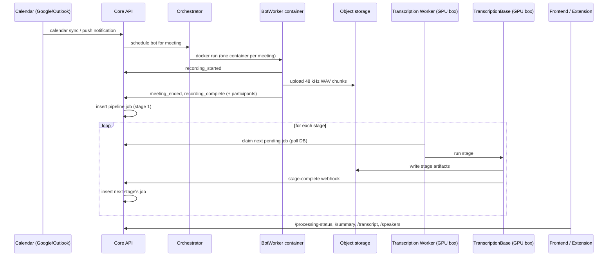

# Memoir — Architecture

This document follows one meeting from capture to CRM, then covers the cross-cutting pieces (auth, data, deployment) and the main design decisions.

## 1. End-to-end flow

### Capture paths

| Path | How audio arrives | Where it enters |
|------|-------------------|-----------------|
| Meeting bot | Playwright drives Chromium inside a container with Xvfb + a virtual audio sink (PipeWire, or PulseAudio); FFmpeg records the sink to 48 kHz PCM WAV chunks | BotWorker → webhooks to Core API |
| Chrome extension | An MV3 offscreen document captures the tab (mixed, or tab + mic as separate tracks); content scripts scrape participant names | `tab_audio` endpoints on Core API |
| Web recorder | Browser `getUserMedia` / screen capture from the `/record` page (hands off to the extension when installed) | Core API |
| Upload / link | File or media URL | Core API |

All paths converge on the same pipeline jobs, so downstream processing does not care where audio came from.

## 2. Processing pipeline

Processing is a chain of **database-backed jobs** (`transcription_jobs`, keyed by `operation_type`). The transcription worker polls for pending jobs and runs them on the GPU service; each finished stage calls a webhook on the Core API, which inserts the next job.

| Order | Op type | Stage | Output |
|-------|---------|-------|--------|
| 1 | 1 | **Preprocess** — audio analysis (level, clipping, noise, bandwidth), normalization, VAD | analysis + cleaned audio |
| 2 | 4 | **Enhance** — applied only if analysis says it helps | enhanced audio |
| 3 | 6 | **Diarize** — pyannote speaker segmentation on the preprocessed audio | who-spoke-when |
| 4 | 7 | **Fast ASR + summary** — faster-whisper with word timestamps, then an LLM summary | first transcript + summary (shown to the user early) |
| 5 | 5 | **ASR + post-processing** — full transcription, CTC forced alignment, vocabulary / phonetic / LLM correction, speaker mapping | final transcript, named speakers |
| 6 | 3 | **Intelligence** — multi-prompt LLM pipeline (classification, pain points, objections, competitors, deal momentum, FAQ) + coaching metrics | `intelligence.json` |
| 7 | 2 | **CRM extraction** — structured fields for HubSpot / Zoho | CRM payload, synced by the integration service |

Real-time progress (percent + label) for each job is written to a Redis hash by TranscriptionBase and read by the Core API's `/processing-status` endpoint. Clients poll that endpoint and fetch each artifact only once its stage has finished.

### Speaker identification

1. Diarization produces anonymous speakers (`SPEAKER_00`, …).
2. An ECAPA-TDNN embedding is computed per speaker.
3. Each speaker is scored against stored profiles by cosine similarity. A profile's score is `max(quality-weighted average over its samples, best single sample)`; matches below 0.70 are skipped.
4. Pairs are assigned greedily, best score first, with each speaker and profile used at most once. Participant names scraped from the meeting (with the bot's own name filtered out) inform the remaining speakers.
5. New embedding samples are stored against profiles, so matching improves over time.

### LLM layer

Prompts are versioned and loaded through a provider registry, so the same pipeline can run on Claude (production), Gemini or Groq (development), or a local Ollama model. LangSmith tracing can be turned on per prompt. Malformed JSON from the model is repaired and logged rather than failing the stage.

## 3. Cross-cutting concerns

### Authentication and authorization
- **Gateway:** Traefik calls `auth_service /auth/verify` (ForwardAuth) on protected routes and forwards `X-User-*` / `X-User-Scopes` headers upstream, so the other services don't re-implement session handling.
- **Tokens:** ES256 JWTs, 15-minute access tokens and 7-day refresh tokens. Refresh tokens rotate within a *family*; replaying an already-used token revokes the whole family (theft detection). The frontend sends all concurrent refreshes through a single in-flight request so legitimate parallel calls never look like reuse.
- **RBAC:** scope definitions plus a `require_scope()` dependency; team-membership lookups are cached briefly.
- **Service-to-service:** a shared internal key header for webhooks and internal endpoints.

### Data
- **PostgreSQL:** `auth_db` (auth only) and `videoclip_db` (core API, integration service, pipeline jobs). UUID primary keys, async SQLAlchemy + asyncpg, Alembic migrations.
- **Redis:** auth sessions; cached `/status` and `/processing-status` responses (invalidated on webhook events); pipeline progress.
- **Object storage:** audio and per-stage artifacts behind one storage abstraction (`videoclip_common`) that supports S3, Cloudflare R2, and local disk.

### Observability
- Every request logs a structured `[REQ]` line with response time, DB time, query count, and total time, collected via a middleware and SQLAlchemy engine listeners that share request-scoped context variables.
- LLM calls are traced (optional) with token and cost accounting.

## 4. Deployment (as run in production)

- **Application box:** AWS EC2 (ap-south-1) running the gateway, auth, core API, integration, notification, frontend, and orchestrator under systemd; bot containers run on the same host.
- **Database:** AWS RDS PostgreSQL. **Storage:** Cloudflare R2.
- **GPU box:** a rented on-demand GPU machine running TranscriptionBase and the transcription worker; a bootstrap script detects the hardware and picks model settings.
- **Infrastructure as code:** Terraform (`terraform/`); setup and deploy scripts in `scripts/`.

## 5. Design decisions

| Decision | Why |
|----------|-----|
| **Split CPU and GPU workloads onto separate machines** | The web/API tier needs to be always on and is cheap; GPU time is expensive and bursty. Coupling them only through the database and webhooks lets the GPU box be replaced or scaled independently. |
| **Pipeline as chained DB jobs instead of one long task** | A failure in, say, diarization retries that stage only. The user gets a summary from the fast stage in minutes while heavier stages run. Every stage's status is queryable. |
| **Poll the database for jobs (worker) rather than push** | The GPU box can sit behind NAT and go offline without losing work; jobs simply wait. Exactly one worker may poll, to avoid two workers racing on the same job. |
| **One Docker container per meeting bot** | Browser automation is fragile. Isolation means one stuck meeting can't take others down, resources are released by removing the container, and the bot's system dependencies (Xvfb, audio server, Chromium) stay out of the host. |
| **Lossless 48 kHz audio end to end** | Recordings were originally 128 kbps Opus and the pipeline resampled to 16 kHz. Switching to PCM WAV at 48 kHz keeps the high-frequency consonant detail; only the ASR step downsamples to 16 kHz, because Whisper requires it. Storage is cheap compared with transcription errors. |
| **Detection-first enhancement** | Published evidence shows blanket denoising tends to increase word error rate, so enhancement runs only when the analysis flags a problem. Diarization runs on the preprocessed (not enhanced) audio, because enhancement flattens the voice characteristics that separate speakers. |
| **Cookie-based bot authentication** | A persistent Chromium profile created on macOS crashed in the Linux container; injecting exported cookies into a fresh browser context is portable and simpler. |
| **Cache status endpoints in Redis** | Clients poll status every few seconds during a meeting; serving those reads from Redis keeps them off the database connection pool. |
| **Batch queries / single-SQL aggregates** | Each database round-trip was ~0.5 s under production load, so cutting the *number* of queries mattered far more than micro-optimizing any one of them. |
