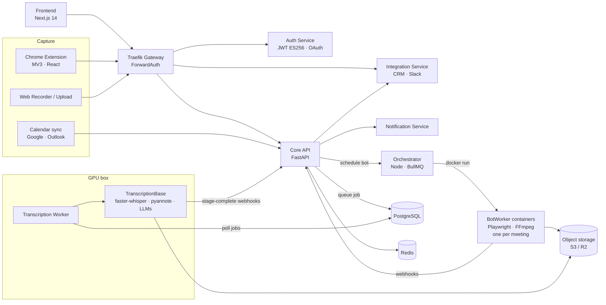

# Memoir

**An AI meeting-intelligence platform: it joins or captures your meetings, transcribes them with speaker identification, and turns each conversation into a summary, sales intelligence, and CRM updates.**

Designed, built, and operated end-to-end as a solo project (January – June 2026). Ran in production on AWS with GPU inference on separate machines; the Chrome extension is published on the Chrome Web Store.

<!-- TODO: add demo video link + a screenshot of the meeting detail page here
[▶ Watch the 3-minute demo](https://youtu.be/...)

-->

---

## What it does

1. **Capture** a meeting in one of four ways:
   - a **meeting bot** that joins Google Meet calls from the user's calendar,
   - a **Chrome extension** that records the browser tab (single mixed stream, or separate tab + mic tracks),
   - a **web recorder** page in the app,
   - **file / link upload**.
2. **Transcribe** with a multi-stage speech pipeline: audio analysis → speaker diarization → speech recognition → word alignment → vocabulary and LLM-based correction.
3. **Identify speakers** by name: voice embeddings are matched against stored speaker profiles, combined with participant names scraped from the meeting.
4. **Analyze** with an LLM pipeline: summary and action items, call classification, pain points, objections, competitors, deal momentum, FAQs, coaching metrics.
5. **Sync** extracted fields to the CRM (HubSpot, Zoho) and notify the team (email, Slack, in-app).

## Architecture



See **[ARCHITECTURE.md](ARCHITECTURE.md)** for the end-to-end data flow, the processing stages, and the design decisions behind them.

### Services

| Service | Stack | Role |
|---------|-------|------|
| `frontend/` | Next.js 14, React, TypeScript, Tailwind, Zustand | Meetings and events views, meeting detail (transcript, speakers, summary, CRM data), analytics, admin |
| `api_gateway_service/` | Traefik v3 | Routing, TLS, ForwardAuth, security headers |
| `auth_service/` | FastAPI, async SQLAlchemy | Signup/login, Google & Microsoft OAuth, ES256 JWT with refresh-token family rotation, RBAC scopes |
| `core_api/` | FastAPI, async SQLAlchemy, Redis | Meetings, calendar sync and bot scheduling, pipeline webhooks, speaker mapping, intelligence, admin |
| `integration_service/` | FastAPI | HubSpot / Zoho CRM sync, Slack |
| `notification_service/` | FastAPI | Email, Slack, in-app notifications |
| `orchestrator/` | Node.js, TypeScript, Express, BullMQ, Docker API | Job queue that launches and supervises one bot container per meeting |
| `BotWorker/` | Python, Playwright, FFmpeg, PipeWire/PulseAudio, Xvfb | Headless meeting bot: joins the call, records lossless audio, scrapes participants |
| `transcription_worker/` | Python, asyncpg | Polling daemon that claims pipeline jobs and dispatches them to the GPU service |
| `TranscriptionBase/` | FastAPI, PyTorch, faster-whisper, pyannote, ctc-forced-aligner | Speech pipeline + LLM intelligence pipeline |
| `resemble_enhance/` | FastAPI | Optional audio enhancement |
| `chrome_extension/` | TypeScript, React, Webpack (MV3) | In-browser recording via offscreen document, floating in-meeting UI |
| `videoclip_common/` | Python package | Shared JWT verification, storage abstraction (S3 / R2 / local), HTTP clients, RBAC |

**Data:** PostgreSQL 16 (`auth_db`, `videoclip_db`, 42 Alembic migrations), Redis 7 (sessions, status cache, progress), S3-compatible object storage.

## Engineering highlights

- **Staged, restartable speech pipeline.** Processing is split into seven job types (preprocess → enhance → diarize → fast transcript + summary → full transcription + correction → intelligence → CRM), each its own database-backed job chained by webhooks. A short summary is ready within minutes while the heavier stages continue, and a failed stage can be retried without redoing the rest.
- **One container per meeting.** The orchestrator runs every bot in an isolated Docker container (virtual display, virtual audio sink, Chromium), so a crash or hang in one meeting cannot affect another; a reaper cleans up stale containers.
- **Speaker identification.** ECAPA-TDNN voice embeddings are matched to saved speaker profiles by cosine similarity. Scoring uses the maximum of the quality-weighted average and the best single sample, after the weighted average alone was found to push genuine matches below the 0.70 threshold for speakers with acoustically varied samples.
- **Detection-first audio processing.** Audio is analyzed first (clipping, noise, bandwidth) and enhanced only when needed, following evidence that blanket denoising increases word error rate.
- **Lossless capture.** Bot recordings are 48 kHz 16-bit PCM WAV end to end, avoiding compression artifacts before ASR and diarization.
- **Performance under load.** Production profiling found per-call Redis connections and N+1 query patterns. A shared connection pool cut webhook dispatch from ~1.7 s to ~23 ms; batching queries and folding multi-query dashboards into single SQL statements relieved database connection-pool pressure. Per-endpoint timing (request, DB, and total time) was added to find these hot spots.
- **Security.** Gateway-level ForwardAuth, ES256 JWTs with refresh-token family rotation (reuse of a refresh token revokes the family), scope-based RBAC, and a separate key for service-to-service calls.

## Running locally

Requirements: Python 3.12, Node.js 20, PostgreSQL 16, Redis 7, Docker. On macOS:

```bash
cp core_api/.env.example core_api/.env   # repeat for each service that has an .env.example
./dev.sh             # creates databases, runs migrations, syncs JWT keys, starts services
./dev.sh status      # what's running
./dev.sh logs api    # tail one service
./dev.sh stop
```

Alternatively, `docker compose up` from the repo root starts Postgres, Redis, MinIO, the gateway, auth, core API, and the integration service.

**Notes**
- The speech pipeline (`TranscriptionBase/`, `transcription_worker/`) needs an NVIDIA GPU and a Hugging Face token for the pyannote models. See `TranscriptionBase/README.md`.
- The meeting bot needs Docker (Xvfb, an audio server, and Chromium inside the container); it does not run directly on macOS.
- The Chrome extension builds with `cd chrome_extension && npm ci && npm run build`, then load `dist/` as an unpacked extension.

## Tests

```bash
cd core_api && python -m pytest -q     # 113 tests: meetings/events API, status cache, calendar sync + token refresh, web recorder
cd BotWorker && python -m pytest -q    # 77 tests: bot lifecycle, recorder, audio merge, API
```

CI (`.github/workflows/ci.yml`) runs both suites and type-checks the frontend, orchestrator, and Chrome extension.

## Repository layout

```
├── frontend/               Next.js web app
├── chrome_extension/       MV3 extension
├── api_gateway_service/    Traefik config
├── auth_service/           Auth + OAuth + JWT
├── core_api/               Main API (+ alembic/ migrations)
├── integration_service/    CRM + Slack
├── notification_service/   Email / Slack / in-app
├── orchestrator/           Bot job queue + container manager
├── BotWorker/              Meeting bot image
├── transcription_worker/   GPU job poller
├── TranscriptionBase/      Speech + LLM pipeline
├── resemble_enhance/       Audio enhancement
├── videoclip_common/       Shared Python library
├── terraform/              AWS infrastructure
└── scripts/                Setup and deploy scripts
```

## License

All rights reserved. The source is shared for review; please contact the author before reusing it.
